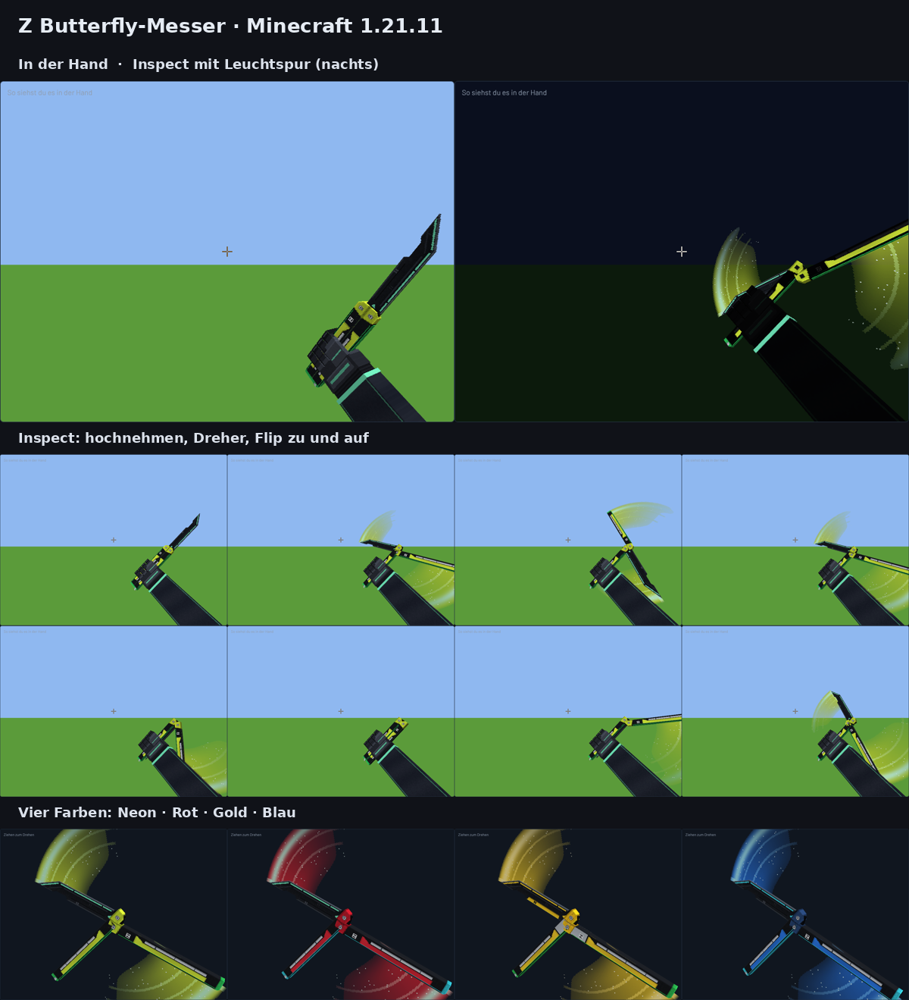

# Z Butterfly-Messer (Minecraft Java 1.21.6 – 1.21.11)

Ein 3D-Butterfly-Messer (Balisong) im Neon-Look für Minecraft, gemacht für den Z Client (1.21.11).
Eigenes Design nach dem Vorbild des Valorant-Messers, ohne Logos oder Dateien von Riot.



**Was drin ist**

- Echtes 3D-Modell: Klinge mit Fase, erhöhter Rückenplatte und Akzentlinien, zwei Griffe mit
  Leucht-Einlagen, Schrauben, Führungsschienen, Verschluss und Z-Logo
- **Vier Farben:** Neon (Gelb/Grün), Rot, Gold, Blau
- **Flip-Animation:** Rechtsklick gedrückt halten, dann klappt das Messer auf und zu (2 Sekunden pro Durchgang)
- **Leuchtet im Dunkeln:** Einlagen, Köpfe, Seitenleisten und Klingenlinien glühen
- Passende Haltung in der Hand (rechts und links), in der 3. Person, im Inventar, auf dem Boden und im Rahmen

## Installieren

1. [`Z-Butterfly-Messer-Ressourcenpaket.zip`](Z-Butterfly-Messer-Ressourcenpaket.zip) herunterladen
   (nicht entpacken).
2. In den Ordner `resourcepacks` deines Minecraft- bzw. Z-Client-Ordners legen.
3. Im Spiel unter **Optionen → Ressourcenpakete** aktivieren.

## Messer bekommen

**A) Schwert im Amboss umbenennen** (geht auch im Überleben und auf Servern):

| Name im Amboss | Farbe |
| --- | --- |
| `Butterfly` (oder `Butterfly Messer`, `Balisong`) | Neon |
| `Butterfly Rot` | Rot |
| `Butterfly Gold` | Gold |
| `Butterfly Blau` | Blau |

Funktioniert mit jedem Schwert (Holz bis Netherit). Die Flip-Animation gibt es nur bei B und C.

**B) Befehl** (Cheats an), mit Flip-Animation:

```
/give @s iron_sword[item_model="zknife:butterfly_neon",item_name="Butterfly Neon",consumable={consume_seconds:100000,animation:"none",has_consume_particles:false},use_effects={can_sprint:true,speed_multiplier:1}]
```

Für die anderen Farben `neon` durch `rot`, `gold` oder `blau` ersetzen.

**C) Datenpaket** (nur 1.21.11): [`Z-Butterfly-Messer-Datenpaket.zip`](Z-Butterfly-Messer-Datenpaket.zip) in den
Ordner `datapacks` der Welt legen (oder beim Erstellen der Welt hinzufügen). Dann:

- **Herstellen:** Eisenschwert + Farbstoff + Glowstone-Staub (formlos) –
  Hellgrün = Neon, Rot = Rot, Gelb = Gold, Hellblau = Blau
- **Befehl:** `/function zknife:neon` (oder `rot`, `gold`, `blau`, `alle`)

## Gut zu wissen

- Andere Spieler sehen das Modell nur, wenn sie das Ressourcenpaket auch aktiviert haben.
  Ohne Paket sehen sie ein normales Eisenschwert.
- Beim Flippen (B/C) kannst du normal laufen und sprinten. Solange du Rechtsklick hältst, wird nicht
  angegriffen und mit der zweiten Hand kein Block gesetzt.
- Schaden und Haltbarkeit sind die eines Eisenschwerts (beim Umbenennen die des jeweiligen Schwerts).

## Selbst anpassen

Alles wird von [`tools/build.py`](tools/build.py) erzeugt: Form, Farben, Animation und beide Pakete.
Farben ändern: `VARIANTS` im Skript anpassen, dann bauen:

```
pip install pillow
python3 tools/build.py
```

Die Pakete landen wieder in diesem Ordner. Die entpackten Dateien und eine 3D-Vorschau zum Drehen und
Flippen (`build/vorschau.html`, im Browser öffnen) kommen nach `build/`.
