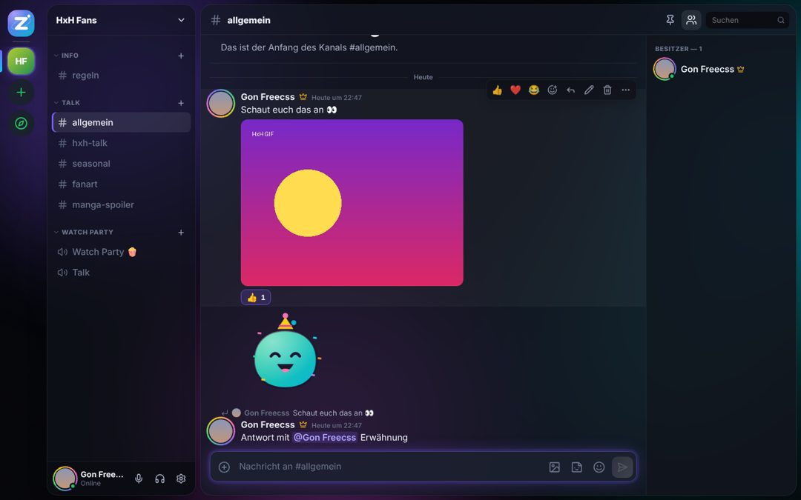
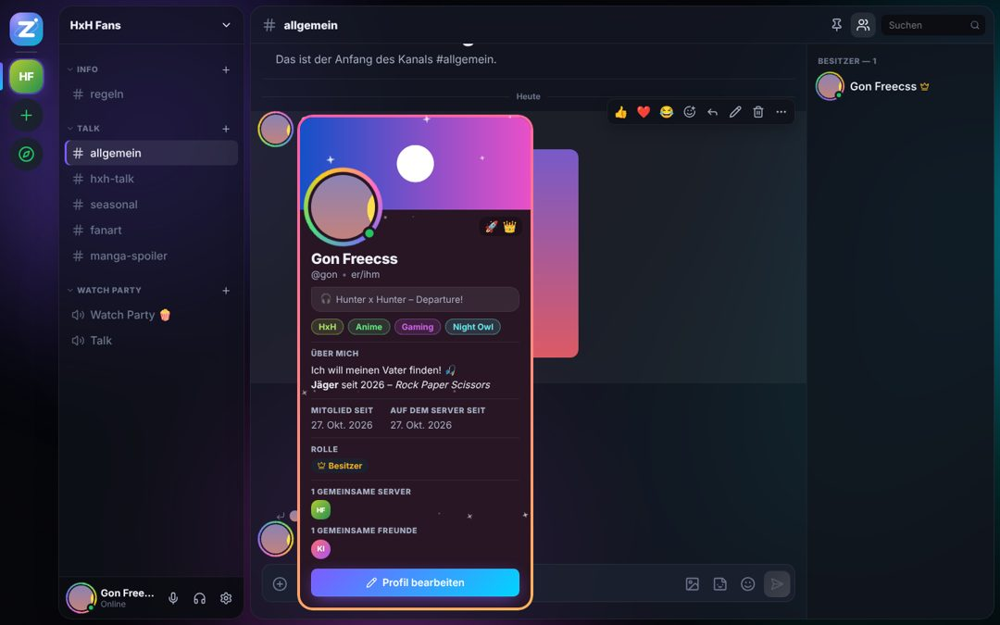
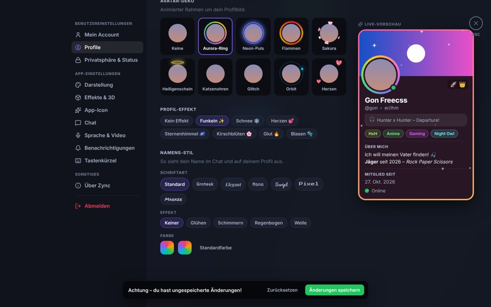
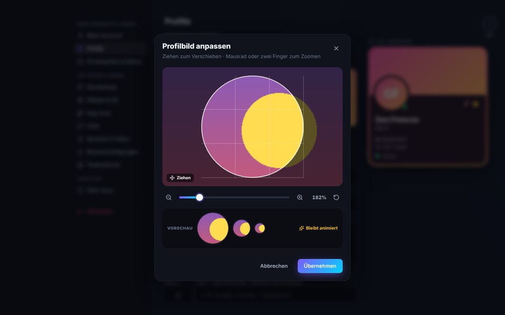
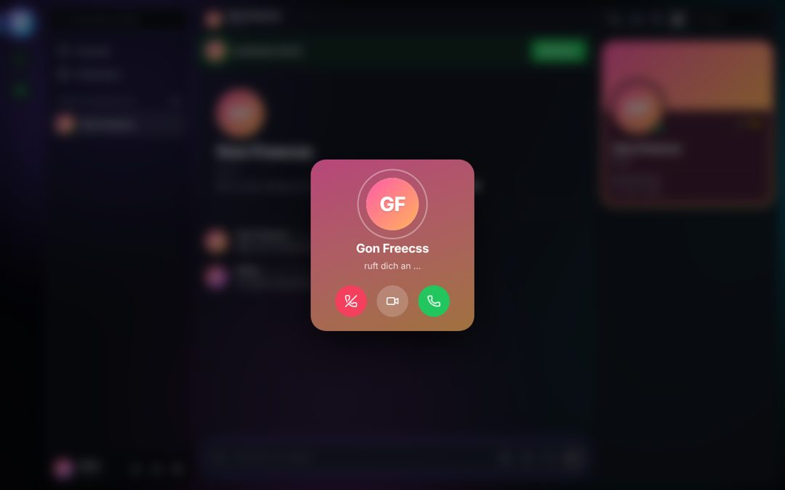
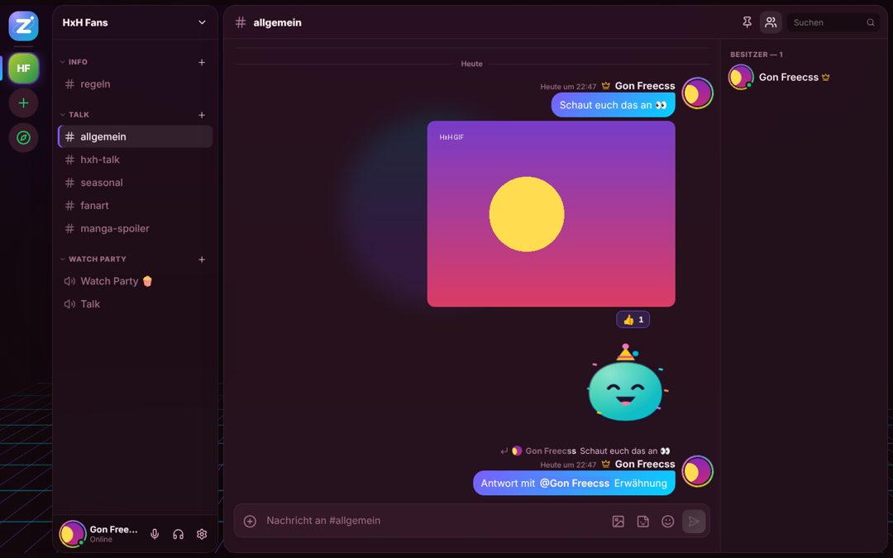
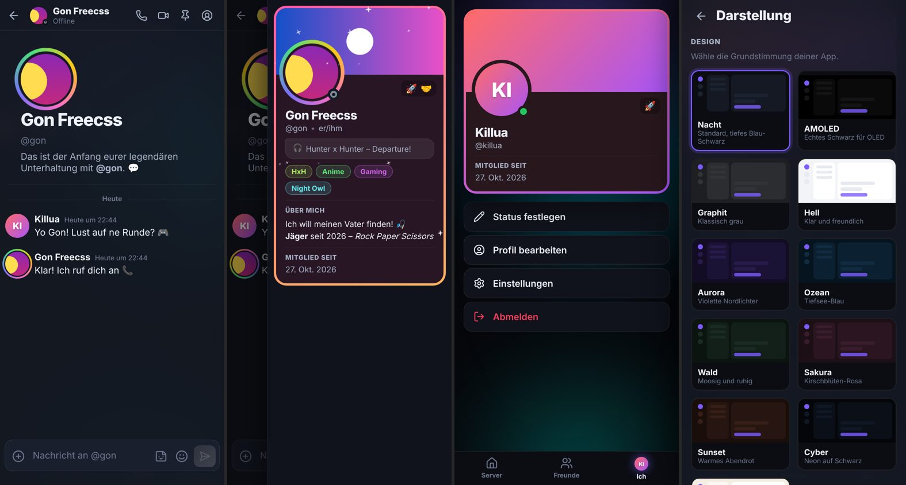

# ⚡ Zync – Verbinde. Teile. Vibe.

Zync ist eine moderne Chat-, Voice- und Streaming-App – wie Discord, nur ohne Bezahlschranke:
GIF-Profilbilder, Banner, Streams in 4K/60 und alle Designs sind für alle kostenlos.
Läuft im **Browser**, als **Handy-App** und als **Desktop-App (Windows/macOS/Linux)**.

| Chat | Profil | Profil-Editor |
|---|---|---|
|  |  |  |
| **Zuschnitt (Zoom & Ziehen, GIF bleibt animiert)** | **Eingehender Anruf** | **Theme „Sakura“ + Sprechblasen** |
|  |  |  |



## Was Zync kann

**Chat**
- Nachrichten mit Markdown (**fett**, *kursiv*, `Code`, Codeblöcke, `||Spoiler||`, Zitate, Listen, Überschriften), bis 4000 Zeichen
- Antworten, Bearbeiten (auch mit ↑), Löschen, Anpinnen, Reaktionen, Suche im Kanal, Ungelesen-Marker
- Fotos, Videos, GIFs & Dateien bis **100 MB** (Drag & Drop, Einfügen aus der Zwischenablage, Spoiler-Markierung)
- Emoji-Picker mit Suche & „Zuletzt benutzt“, `:shortcodes:`, Emoticons (`:)` → 🙂), große Emojis
- **Sticker**: animiertes Zynci-Paket (16 Sticker) + eigene Sticker hochladen
- **GIF-Favoriten**: jedes Bild/GIF im Chat mit ⭐ speichern
- @Erwähnungen mit Autovervollständigung, @everyone, „… schreibt“-Anzeige

**Freunde & Server**
- Freunde per Benutzername hinzufügen, Anfragen annehmen/ablehnen, entfernen, blockieren, „Gerade aktiv“
- Direktnachrichten und Anrufe 1:1
- Server erstellen mit Vorlagen (Freunde, Gaming, Anime-Fanclub, Community, Lerngruppe …)
- Text- & Sprachkanäle, Kategorien, Einladungslinks, Rollen (Besitzer/Admin/Mitglied), Spitznamen, Kick, Besitz übertragen
- Server-Icon & Banner (auch GIF) mit Zuschnitt, Akzentfarbe, öffentlich in „Entdecken“

**Voice, Video & Streams**
- Sprachkanäle und DM-Anrufe (Klingeln, Annehmen mit/ohne Video, Ablehnen)
- Kamera, **Bildschirmübertragung bis 4K/60 FPS** mit Systemton, Bild-in-Bild, Vollbild, Spotlight
- Mikrofon-Pipeline: Rauschunterdrückung, Echounterdrückung, Auto-Verstärkung, Eingangslautstärke bis 200 %,
  automatische oder manuelle Empfindlichkeit, **Push-to-Talk**, Opus bis 256 kbps
- Lautstärke pro Person (Rechtsklick auf Kachel), Ausgabegerät wählbar, Mikrofon-Test mit Pegelanzeige, Kamera-Vorschau

**Profil**
- Profilbild & Banner **auch als GIF**, vorher zoomen und Ausschnitt verschieben (Maus, Mausrad, Pinch, Pfeiltasten)
- Anzeigename, Pronomen, Status-Text, „Über mich“ (Markdown), **Tags** (z. B. HxH, Anime, Gaming …), „Vibe“/Lieblingssong
- Profil-Farbverlauf, **Avatar-Dekos** (Aurora-Ring, Neon, Flammen, Sakura, Heiligenschein, Katzenohren, Glitch, Orbit, Herzen)
- **Profil-Effekte** (Funkeln, Schnee, Herzen, Sternenhimmel, Kirschblüten, Glut, Blasen)
- **Namens-Stil**: Schriftart (Elegant, Script, Pixel, Marker …), Effekt (Glühen, Schimmern, Regenbogen, Welle), Farbverlauf
- Status: Online, Abwesend, Nicht stören, Unsichtbar

**Social & Fun (neu)**
- 🔥 **Flammen (Streaks)** wie bei Snapchat/TikTok: schreibt euch jeden Tag gegenseitig → die Flamme wächst. ⏳ warnt, bevor sie erlischt.
  Meilensteine (3, 5, 7, 10, 30, 100 …) feiern mit animierter Karte, +25 Punkten und „Als Story teilen“.
- 📸 **Stories** (24 h): Foto, Video oder Text mit Hintergründen, Schriften und verschiebbaren Stickern.
  Vollbild-Viewer mit Fortschrittsbalken, Tippen/Halten, Reaktionen, Antworten per DM und Aufruf-Liste.
  Flammen-Stories mit Animation: beide Avatare, lodernde Flamme, hochzählende Tage.
- 🎯 **Tägliche Aufgaben & Punkte**: Check-in, Nachrichten, Reaktionen, Call-Minuten, Story, Flamme, Sticker, Sprachnachricht + Tagesbonus.
- 🛍️ **Shop – Free-to-Play, kein Pay2Win**: Avatar-Dekos (Krone, Blitz, Galaxie, Regenbogen …), Profil-Effekte (Konfetti, Nordlicht …),
  Namens-Effekte (Neon, Feuer, Regenbogen …), Schriften, **Namensschilder** und **Profilrahmen** (Glas, Pixel, Spitze, Engelsflügel, Hologramm).
  Alles nur mit erspielten Punkten, kein Echtgeld.
- 🏅 **Badges & Statistiken**: Zync Owner, „Seit X Tagen/Monaten/Jahren dabei“, Stunden im Call (1h–4000h), gezockte Stunden,
  entdeckte Spiele, Nachrichten, beste Flamme, Aufgaben, Stories, Server-Gründer … mit Stufen Bronze → Legende und Fortschrittsbalken.
- 🎮 **Aktivität**: „Spielt gerade Minecraft“ – manuell oder automatisch erkannt in der Desktop-App (zählt für Spielzeit-Badges).
- 🧩 **Profil-Widgets**: Karten mit Text & Bild, Socials (Instagram, Roblox, TikTok …), „Meine Leute“ (Freunde mit Label wie
  „Mein BF 💕“ oder „Minecraft Atze ⛏️“), Galerie, Erfolge und Gaming. Dazu ein vollständiges Profil mit Tabs.
- 🔗 **Verlinkungen in der Bio**: `@benutzername` wird nur verlinkt, wenn ihr befreundet seid.
- 🔒 **Claimen**: Zwei Freunde reservieren sich ein tägliches Zeitfenster (z. B. 09:00–21:00). Beide müssen zustimmen; in der Zeit
  können andere nicht schreiben oder anrufen. Jeder kann jederzeit beenden.
- 🏷️ **Server-Tags**: Server legen einen Tag an (z. B. `🎣 HXH`), Mitglieder tragen ihn neben ihrem Namen. Klick darauf zeigt den
  Server – öffentliche Server kann man direkt beitreten.
- 🎭 **Rollen**: eigene Rollen mit Farbe, Icon, eigener Gruppe in der Mitgliederliste und Rechten (Server/Kanäle/Rollen verwalten,
  Kicken, Nachrichten verwalten, @everyone, Spitznamen).
- 🎤 **Sprachnachrichten** mit Live-Wellenform beim Aufnehmen, Player mit Spulen und 1×/1,5×/2×.
- 📯 **Soundboard** im Call: 12 eingebaute Sounds (Airhorn, Ba-dum-tss, Tada, Sad Trombone, Applaus …) + eigene Sounds.

**Einstellungen**
- **Darstellung**: 11 Themes (Nacht, AMOLED, Graphit, Hell, Aurora, Ozean, Wald, Sakura, Sunset, Cyber, Latte), Akzentfarben mit
  Verlauf, Schriftarten, UI-/Chat-Skalierung, Eckenrundung, Sättigung, Dichte, Sprechblasen-Modus, **PC-/Handy-Ansicht erzwingen**
- **Effekte & 3D**: animierte Hintergründe (Aurora, 3D-Partikel, Retro-Grid, Wellen, Orbs), Parallax, Glassmorphism,
  Neon-Glow, 3D-Tilt-Karten, 3D-Server-Icons, Animationen reduzieren/aus
- **App-Icon**: 11 Logo-Varianten (Tab-Icon, Desktop-Fenster, Tray)
- **Chat**, **Benachrichtigungen** (Desktop, Sounds, Lautstärke), **Tastenkürzel** (frei belegbar), **Privatsphäre**

## Schnellstart

Voraussetzung: **Node.js 22.13 oder neuer** (nutzt die eingebaute SQLite-Datenbank – keine weiteren Datenbanken nötig).

```bash
cd zync
npm run install:all     # Abhängigkeiten für Server und Client installieren
npm run dev             # Entwicklung: http://localhost:5173
```

Für den echten Betrieb:

```bash
npm start               # baut den Client und startet alles auf http://localhost:3001
```

Daten (Datenbank + Uploads) liegen in `server/data/`.

## Online stellen (für Freunde, Handy, andere PCs)

Mikrofon, Kamera und Bildschirmübertragung funktionieren im Browser nur über **HTTPS** (oder `localhost`).
Am einfachsten: Zync hinter einen Reverse-Proxy mit automatischem Zertifikat stellen, z. B. [Caddy](https://caddyserver.com):

```
zync.deine-domain.de {
    reverse_proxy localhost:3001
}
```

| Umgebungsvariable | Bedeutung |
|---|---|
| `PORT` | Port des Servers (Standard `3001`) |
| `ZYNC_DATA` | Ordner für Datenbank und Uploads (Standard `server/data`) |
| `ZYNC_TLS_CERT`, `ZYNC_TLS_KEY` | Pfade zu Zertifikat/Schlüssel → Zync spricht direkt HTTPS |
| `ZYNC_TRUST_PROXY=1` | Hinter einem Reverse-Proxy setzen (korrekte IPs fürs Rate-Limit) |
| `ZYNC_OWNERS` | Benutzernamen mit „Zync Owner“-Badge, mehrere mit Komma (Standard `coolersteinyt`) |
| `ZYNC_BACKUP_URL` | Postgres-Verbindung (z. B. kostenlos bei [Neon](https://neon.tech)) für die automatische Sicherung – siehe unten |
| `ZYNC_TZ` | Zeitzone für Flammen, Aufgaben-Reset und Claims (Standard `Europe/Berlin`) |
| `ZYNC_TURN_URL`, `ZYNC_TURN_USER`, `ZYNC_TURN_PASS` | TURN-Server für Anrufe durch strenge Firewalls/Mobilfunk (z. B. [coturn](https://github.com/coturn/coturn)) |

### Daten sichern bei Gratis-Hosting (Render Free)

Render Free löscht bei jedem Neustart, Deploy und nach 15 Minuten Leerlauf alle Dateien – also auch
Accounts und Nachrichten. Mit `ZYNC_BACKUP_URL` sichert Zync die Datenbank und Uploads automatisch in
eine Postgres-Datenbank und holt sie beim Start zurück:

1. Bei [neon.tech](https://neon.tech) mit GitHub anmelden → Projekt anlegen (kostenlos, ohne Kreditkarte).
2. Auf **Connect** tippen und den Connection-String kopieren (`postgresql://…?sslmode=require`).
3. Bei Render → dein Dienst → **Environment** → `ZYNC_BACKUP_URL` = dieser String → speichern.

Gesichert wird alle 3 Minuten (nur bei Änderungen) und immer beim Herunterfahren. Uploads über 20 MB
werden nicht gesichert (`ZYNC_BACKUP_MAX_FILE_MB`). Ist die Datenbank beim Start nicht erreichbar,
läuft Zync ohne Sicherung weiter und überschreibt das alte Backup nicht.

Anrufe und Streams laufen direkt zwischen den Teilnehmern (WebRTC, Peer-to-Peer) – der Server vermittelt nur.
Ohne TURN-Server klappt das in den meisten Heimnetzen; in Firmen-/Schulnetzen oder im Mobilfunk hilft ein TURN-Server.

## Handy-App

- **Android-App (APK):** wird automatisch per GitHub Actions gebaut und liegt auf jedem Zync-Server unter
  `/downloads/zync.apk` – in Zync unter *Einstellungen → Zync-Apps*. Beim ersten Start die Server-Adresse eingeben.
- **iPhone (Web-App):** Zync in Safari öffnen → Teilen → „Zum Home-Bildschirm“. Läuft dann im Vollbild wie eine App.
- Details und selbst bauen: [`mobile/README.md`](mobile/README.md) (Capacitor).

Die Oberfläche erkennt Handys automatisch (eigene Handy-Ansicht mit Tab-Leiste, Wischnavigation, Bottom-Sheets).
In *Einstellungen → Darstellung → Ansicht* kann man die Handy- oder PC-Ansicht auch erzwingen.

## Desktop-App (Windows, macOS, Linux)

```bash
cd desktop
npm install
npm start                       # verbindet sich mit http://localhost:3001
ZYNC_URL=https://zync.deine-domain.de npm start
npm run dist:win                # Installer bauen (bzw. dist:mac / dist:linux)
```

Extras der Desktop-App: eigene Fensterleiste, Bildschirm-/Fensterauswahl beim Streamen, Systemton-Übertragung (Windows),
Tray-Icon, im Hintergrund weiterlaufen, globale Tastenkürzel (Strg+Shift+M stumm, Strg+Shift+D Ton aus), App-Icon-Varianten.
Die Server-Adresse lässt sich jederzeit über das Tray-Menü ändern.

## Projektstruktur

```
zync/
├── server/      Node.js + Express + Socket.IO + SQLite (Accounts, Freunde, Server, Nachrichten, Uploads, Voice-Signalisierung)
├── client/      React + Vite (Web-App, PWA, Handy- und PC-Ansicht)
├── desktop/     Electron-Hülle für Windows/macOS/Linux
├── mobile/      Capacitor-Projekt für Android/iOS
└── docs/        Screenshots
```

## Tastenkürzel

| Kürzel | Aktion |
|---|---|
| `Strg + K` | Schnellsuche (Kanäle, Personen, Server) |
| `Strg + Shift + M` / `D` | Stummschalten / Ton aus |
| `V` (gedrückt halten) | Push-to-Talk (wenn aktiviert, frei belegbar) |
| `Enter` / `Shift + Enter` | Senden / neue Zeile |
| `↑` | Letzte eigene Nachricht bearbeiten |
| `Tab` | @Erwähnung oder :emoji: vervollständigen |
| `Shift + Klick` auf 🗑 | Ohne Nachfrage löschen |
